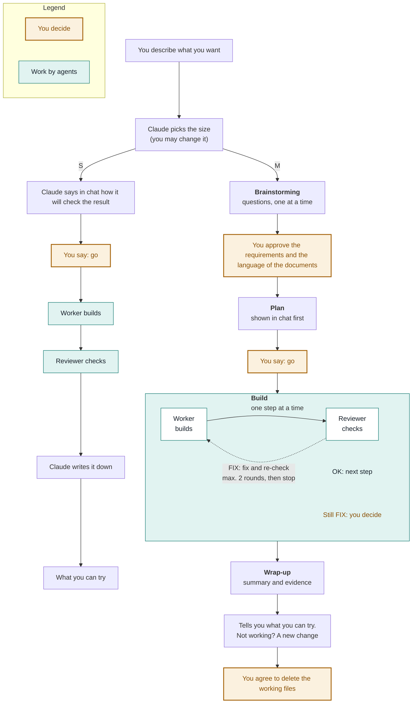

*For people who are new to Claude Code*

# Getting started with b6

b6 is a plug-in for Claude Code that makes Claude slow down before it builds. First you agree on what you want. Then the work is done in small steps, and a second, fresh Claude checks every result.

Why: left alone, Claude may run off and build the wrong thing. With b6 nothing is built until you approve the requirements and say "go" to the plan, and every result is checked against what you asked for. You do not need to be a programmer. Claude writes and keeps the documents, you answer questions and decide.

## Before you start

- Open Claude Code in your project folder.
- Install the plugin. The steps are in [`README.md`](../README.md) in the plugin folder.
- Use a strong model (Opus). The plugin works best with it. If your chat is not on a strong model, Claude tells you before the plan.
- Git is recommended, not required. Git keeps the history of your files. With git, working files are deleted only after a commit (saving the state of the files in history) that you agree to, so they stay in history. Without git, Claude asks before it deletes them.
- Safe with data: work only in your company Claude account, never a private one. Do not put personal data or whole exports into the chat or the project unless the task really needs them; made-up data is enough for trying things out. Never write passwords, keys or access details into the chat or into project files.

## The whole way in one picture

An agent is another Claude that gets one specific job. The `worker` builds, the `reviewer` checks.

Size S is a small change in one or two existing files. Everything else is size M. **Orange boxes** are the moments when you decide. In Build, a fresh reviewer checks every result. If it finds a problem, a worker fixes it, in at most two rounds. After that Claude stops and tells you.

## Step by step (size M)

M is a new feature, several files, or an unclear request. When in doubt, Claude treats it as M. Documents mentioned below are explained in the guide [project-memory.html](project-memory.html).

### 1. You say what you want

`chat`

Write it in your own words. If the project already has `ctx/TASKS.md`, Claude first says in two or three sentences where the project stands and what waits for you. On first use Claude only tells you what it will create (`ctx/`, `docs/`, lines in `CLAUDE.md`) and asks for consent, with at most one question about your request in the same message. It creates nothing yet.

> **You can write**
>
> I want to add a booking page for the meeting rooms.

### 2. Brainstorming: Claude asks, you answer

`ctx/requirements.md`

Claude first looks at what the project already has. Then it asks one question per message. At first the questions are open; later it offers options with a recommendation. For a hard-to-undo choice it shows two or three ways and recommends one. From time to time it asks "What is wrong or missing?".

Then it shows everything at once: intent, what is out of scope, the requirements (each with a priority, a source and a criterion someone can check), decisions, open questions and a short design. It always asks which language the documents use, even when some already exist; it recommends the language of the existing ones, so languages do not mix. You approve, or say what to change. A "go" here means "write the documents", not "build".

After approval Claude writes `ctx/requirements.md`, `ctx/TASKS.md`, `docs/architecture.md`, decision records if there are any, a design file in `ctx/plans/` and lines in `CLAUDE.md`, including the document language.

> **You can answer**
>
> Yes, that is right. Write the documents in English.

### 3. Plan: you read it and say go

`ctx/plans/`

Claude shows the plan in the chat: a table of steps with how each one is checked, choices for you with a recommendation, and a rough token estimate (a token is a small piece of text; work and cost are measured in tokens). Then it asks you to agree. It takes the document language from `CLAUDE.md` and confirms it in one sentence. It writes no file and starts no work before you agree.

After "go" the plan is saved to `ctx/plans/` and a task is added to `ctx/TASKS.md`. A saved plan is never changed; a change means a new plan.

> **To start**
>
> go

> **To save the plan only**
>
> Write the plan, but don't build yet.

### 4. Build: agents work, you wait

`ctx/plans/2026-11-20-due-dates/`

The run folder is named after the date and a short name of the task, like this. For each step Claude writes a brief and starts a `worker` agent. Claude then looks at the result itself, and a fresh `reviewer` agent checks it. The main chat does no work itself. If the reviewer finds problems, a new worker fixes them. There are at most two rounds of fixes. Progress is kept in `SUMMARY.md` in the run folder. If an agent finds a conflict or a choice, Claude brings it to you with a recommendation and does not decide for you.

### 5. Wrap-up: what you can try

`ctx/requirements.md`

Claude tells you what was made, what was checked (command and result) and what is still open. A requirement gets the status `met` with evidence only when a fresh reviewer approved it with evidence for every criterion; you do not have to try it. (If you choose Slovak documents, the statuses are `splnená` and `čiastočne splnená`.) Then Claude tells you what you can try, in steps. This is information only; Claude does not ask whether you tried it.

If you accept the result with a gap after two fix rounds, the requirement is `partly met` and Claude writes what is missing. If you find later that something does not work, tell Claude: the requirement goes back to `approved` and the next step is a new change.

> **If something does not work**
>
> This does not work: after cancelling a booking the event stays in the calendar.

### 6. Clean up: you decide what is deleted

`ctx/plans/`

The design, the plan and the run folder are working files. Requirements, decisions and architecture stay. With git, Claude asks if it may commit, then deletes. Without git, Claude asks "Delete the plan, design and working folder?" and deletes only after your clear "delete". If you do not want the commit now, the files stay, as with "Not yet".

> **To delete**
>
> delete

> **To keep them for now**
>
> Not yet.

## A small change (size S)

Claude treats a small change in one or two existing files, with no new requirements, as size S. It is lighter:

- No brainstorming, no plan file and no `ctx/` folder.
- Claude says in the chat how it will check the result. You say "go". A worker does it and a fresh reviewer checks it.
- Then it is written down: if behaviour changed, the worker updates `docs/architecture.md` (when the folder `docs/` exists), and evidence goes on the requirement the change touches. Claude tells you what you can try.
- If the change would alter the criterion of an existing requirement or needs a new requirement, it is M. A new feature or a new command is always M, however small.
- S is finished in one chat. If you want to continue later, Claude switches it to M, so that the agreement is written to `ctx/`.
- You may always change the size. Questions, typos and formatting are not work for this method; Claude just does them.

## New chat and continuing

You can close the window at any time. The state is in the files, not in the chat. In a new chat Claude reads `ctx/TASKS.md` and says in two or three sentences where the project stands and what waits for you.

- If a plan or a `SUMMARY.md` exists, Claude says where the work stopped and what comes next. It continues after you agree. It does not ask for the requirements again.
- If a task waits for you, such as a decision or an approval, Claude tells you what it needs from you and continues after your answer.
- If old working files are left over, Claude offers to delete them.
- When the chat gets long (more than half full), Claude writes the state to `ctx/TASKS.md` and `SUMMARY.md` and suggests a new chat.

> **In a new chat you can write**
>
> Where are we?

## When Claude stops

- **A MUST requirement cannot be met.** Claude says so plainly and does not write it as approved. It offers to change the requirement or move it down. You choose.
- **Two rounds of fixes did not pass.** Claude stops and tells you in plain words what is wrong. It does not start a third round. You decide the next step.
- **A change of scope.** The plan is not changed in the middle of a run. A change of scope needs you and a new plan.

What to do: read what Claude reports, ask "why" if something is unclear, and tell Claude how to go on. Claude lists the options and gives a recommendation, but the decision is yours.

## Tips

- Answer one question at a time. Claude asks one question per message.
- Say "why" when you do not understand. Ask for plain words.
- Do not worry about the exact words. "go", "yes, build it" and "rob" all mean the same.
- Cost: the plan shows a rough token estimate. The estimate follows the number of steps: a small step uses about 30-80k tokens, a larger one about 100-200k. After the work the real number is written to `SUMMARY.md`.
- A second guide explains how skills can hold personal and company knowledge: [skills-as-personal-and-company-knowledge.html](skills-as-personal-and-company-knowledge.html).
- What loads when and why the context fills up: [what-loads-when.html](what-loads-when.html).

@panthea.sk
