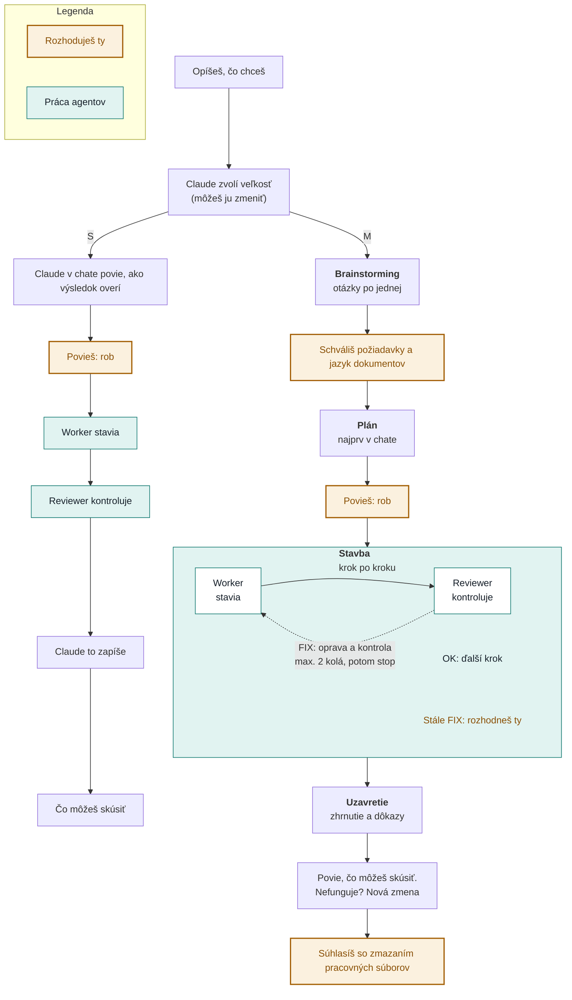

*Pre ľudí, ktorí s Claude Code začínajú*

# Začíname s b6

b6 je plugin pre Claude Code, ktorý Claudea spomalí skôr, než začne stavať. Najprv sa dohodneme, čo chceš. Potom sa práca robí po malých krokoch a každý výsledok skontroluje druhý, nový Claude.

Prečo: sám od seba by Claude mohol utekať do stavby a postaviť nesprávnu vec. S b6 sa nič nestavia, kým neschváliš požiadavky a nepovieš „rob“ na plán, a každý výsledok sa kontroluje voči tomu, čo si chcel. Nemusíš byť programátor. Dokumenty píše a vedie Claude, ty odpovedáš na otázky a rozhoduješ.

## Než začneš

- Otvor Claude Code v priečinku svojho projektu.
- Nainštaluj plugin. Postup je v [`README.md`](../README.md) v priečinku pluginu.
- Použi silný model (Opus). S ním plugin funguje najlepšie. Ak chat nebeží na silnom modeli, Claude ti to povie pred plánom.
- Git sa odporúča, nie je povinný. Git uchováva históriu súborov. S gitom sa pracovné súbory zmažú až po commite (uložení stavu súborov do histórie), s ktorým súhlasíš, takže ostanú v histórii. Bez gitu sa Claude pred zmazaním spýta.
- Bezpečne s dátami: pracuj iba vo firemnom účte Claude, nie v súkromnom. Do chatu ani do projektu nedávaj osobné údaje ani celé exporty, ak ich úloha naozaj nepotrebuje; na skúšanie stačia vymyslené dáta. Heslá, kľúče a prístupové údaje nikdy nepíš do chatu ani do súborov projektu.

## Celý postup na jednom obrázku

Agent je ďalší Claude, ktorý dostane jednu konkrétnu úlohu. `worker` stavia, `reviewer` kontroluje.

Veľkosť S je malá zmena v jednom alebo dvoch existujúcich súboroch. Všetko ostatné je veľkosť M. **Oranžové políčka** sú chvíle, keď rozhoduješ ty. V stavbe každý výsledok skontroluje nový reviewer. Ak nájde problém, worker ho opraví; opravy prebehnú najviac v dvoch kolách. Potom sa Claude zastaví a povie ti to.

## Krok za krokom (veľkosť M)

M je nová funkcia, viac súborov alebo nejasná požiadavka. Ak si Claude nie je istý, berie to ako M. Dokumenty spomenuté nižšie vysvetľuje sprievodca [project-memory.html](project-memory.html).

### 1. Povieš, čo chceš

`chat`

Napíš to vlastnými slovami. Ak projekt už má `ctx/TASKS.md`, Claude ti najprv v dvoch-troch vetách povie, kde projekt stojí a čo čaká na teba. Pri prvom použití ti Claude iba povie, čo vytvorí (`ctx/`, `docs/`, riadky v `CLAUDE.md`), a spýta sa na súhlas, v tej istej správe najviac jednu otázku k tvojej žiadosti. Zatiaľ nič nevytvorí.

> **Môžeš napísať**
>
> Chcem pridať stránku na rezervovanie zasadačiek.

### 2. Brainstorming: Claude sa pýta, ty odpovedáš

`ctx/requirements.md`

Claude sa najprv pozrie, čo projekt už má. Potom sa pýta jednu otázku v jednej správe. Spočiatku sú otázky otvorené, neskôr ponúkne možnosti s odporúčaním. Pri ťažko vratnej voľbe ukáže dve-tri cesty a jednu odporučí. Občas sa spýta: „Čo je nesprávne alebo chýba?“

Potom ukáže všetko naraz: zámer, čo je mimo rozsahu, požiadavky (každá s prioritou, zdrojom a kritériom, ktoré sa dá skontrolovať), rozhodnutia, otvorené otázky a krátky návrh. Vždy sa spýta aj na jazyk dokumentov, aj keď už nejaké sú; odporučí jazyk existujúcich dokumentov, aby sa jazyky nemiešali. Ty schváliš, alebo povieš, čo zmeniť. „rob“ tu znamená „zapíš dokumenty“, nie „stavaj“.

Po schválení Claude zapíše `ctx/requirements.md`, `ctx/TASKS.md`, `docs/architecture.md`, záznamy rozhodnutí (ak nejaké sú), súbor s návrhom v `ctx/plans/` a riadky v `CLAUDE.md`, vrátane jazyka dokumentov.

> **Môžeš odpovedať**
>
> Áno, sedí to. Dokumenty zapíš po slovensky.

### 3. Plán: prečítaš ho a povieš rob

`ctx/plans/`

Claude ukáže plán v chate: tabuľku krokov s tým, ako sa každý overí, voľby pre teba s odporúčaním a hrubý odhad tokenov (token je malý kúsok textu; podľa tokenov sa meria práca aj náklady). Potom sa spýta na súhlas. Jazyk dokumentov si prevezme z `CLAUDE.md` a potvrdí ho jednou vetou. Kým nesúhlasíš, nezapíše žiadny súbor a nezačne žiadnu prácu.

Po „rob“ sa plán uloží do `ctx/plans/` a do `ctx/TASKS.md` pribudne úloha. Uložený plán sa nikdy nemení; zmena znamená nový plán.

> **Na spustenie**
>
> rob

> **Iba uložiť plán**
>
> Zapíš plán, ale ešte nestavaj.

### 4. Stavba: pracujú agenti, ty čakáš

`ctx/plans/2026-11-20-due-dates/`

Priečinok behu sa volá podľa dátumu a krátkeho názvu úlohy, napríklad takto. Pre každý krok Claude napíše zadanie a spustí agenta `worker`. Claude potom výsledok sám pozrie a skontroluje ho nový agent `reviewer`. Hlavný chat sám nerobí žiadnu prácu. Ak reviewer nájde problémy, opraví ich nový worker. Opravy prebehnú najviac v dvoch kolách. Priebeh sa vedie v `SUMMARY.md` v priečinku behu. Ak agent nájde konflikt alebo voľbu, Claude ti ju prinesie s odporúčaním a nerozhodne za teba.

### 5. Uzavretie: čo môžeš vyskúšať

`ctx/requirements.md`

Claude ti povie, čo vzniklo, čo sa overilo (príkaz a výsledok) a čo je ešte otvorené. Požiadavka dostane stav `splnená` s dôkazom až vtedy, keď ju čerstvý reviewer schválil s dôkazom pre každé kritérium; ty ju skúšať nemusíš. (V dokumentoch v angličtine sú stavy `met` a `partly met`; jazyk dokumentov si volíš ty.) Potom ti po krokoch povie, čo si môžeš vyskúšať. Je to len informácia; Claude sa nepýta, či si to skúšal.

Ak po dvoch kolách opráv prijmeš výsledok s medzerou, požiadavka je `čiastočne splnená` a Claude zapíše, čo chýba. Ak neskôr zistíš, že niečo nefunguje, povedz to Claudovi: požiadavka sa vráti na `schválená` a ďalším krokom je nová zmena.

> **Ak niečo nefunguje**
>
> Toto nefunguje: pri zrušení rezervácie ostane udalosť v kalendári.

### 6. Upratanie: rozhodneš, čo sa zmaže

`ctx/plans/`

Súbor s návrhom, plán a priečinok behu sú pracovné súbory. Požiadavky, rozhodnutia a architektúra ostávajú. S gitom sa Claude spýta, či môže spraviť commit, a potom zmaže. Bez gitu sa spýta „Zmazať plán, návrh a pracovný priečinok?“ a zmaže až po tvojom jasnom „zmaž“. Ak commit teraz nechceš, súbory ostanú ako pri „Ešte nie“.

> **Na zmazanie**
>
> zmaž

> **Zatiaľ nechať**
>
> Ešte nie.

## Malá zmena (veľkosť S)

Malú zmenu v jednom alebo dvoch existujúcich súboroch, bez nových požiadaviek, berie Claude ako veľkosť S. Je ľahšia:

- Žiadny brainstorming, žiadny súbor s plánom a žiadny priečinok `ctx/`.
- Claude v chate povie, ako výsledok overí. Ty povieš „rob“. Urobí to worker a skontroluje nový reviewer.
- Potom sa to zapíše: ak sa zmenilo správanie, worker upraví `docs/architecture.md` (ak priečinok `docs/` existuje) a dôkaz sa zapíše k požiadavke, ktorej sa zmena týka. Claude ti povie, čo si môžeš vyskúšať.
- Ak by zmena menila kritérium existujúcej požiadavky alebo potrebuje novú požiadavku, je to M. Nová funkcia alebo nový príkaz je vždy M, aj keď je malá.
- S sa dokončí v jednom chate. Ak chceš pokračovať neskôr, Claude ju prepne na M, aby sa dohoda zapísala do `ctx/`.
- Veľkosť môžeš vždy zmeniť. Otázky, preklepy a formátovanie nie sú práca pre túto metódu; Claude ich jednoducho spraví.

## Nový chat a pokračovanie

Okno môžeš kedykoľvek zatvoriť. Stav je v súboroch, nie v chate. V novom chate Claude prečíta `ctx/TASKS.md` a v dvoch-troch vetách povie, kde projekt stojí a čo čaká na teba.

- Ak existuje plán alebo `SUMMARY.md`, Claude povie, kde sa práca zastavila a čo nasleduje. Pokračuje po tvojom súhlase. Požiadavky sa znova nepýta.
- Ak na teba čaká úloha, napríklad rozhodnutie alebo schválenie, Claude ti povie, čo od teba potrebuje, a po tvojej odpovedi pokračuje.
- Ak ostali staré pracovné súbory, Claude ponúkne ich zmazanie.
- Keď je chat dlhý (viac ako do polovice plný), Claude zapíše stav do `ctx/TASKS.md` a `SUMMARY.md` a navrhne nový chat.

> **V novom chate môžeš napísať**
>
> Kde sme?

## Keď sa Claude zastaví

- **Požiadavka MUST sa nedá splniť.** Claude to povie otvorene a nezapíše ju ako schválenú. Ponúkne zmenu požiadavky alebo jej posunutie nižšie. Vyberieš ty.
- **Dve kolá opráv neprešli.** Claude sa zastaví a jednoducho ti povie, čo je zlé. Tretie kolo nezačne. O ďalšom kroku rozhodneš ty.
- **Zmena rozsahu.** Plán sa uprostred behu nemení. Zmena rozsahu potrebuje teba a nový plán.

Čo robiť: prečítaj, čo Claude hlási, spýtaj sa „prečo“, ak niečo nie je jasné, a povedz Claudeovi, ako ďalej. Claude vypíše možnosti a dá odporúčanie, ale rozhodnutie je tvoje.

## Tipy

- Odpovedaj na jednu otázku naraz. Claude sa pýta jednu otázku v jednej správe.
- Povedz „prečo“, keď niečomu nerozumieš. Popros o jednoduché slová.
- Na presných slovách nezáleží. „go“, „yes, build it“ aj „rob“ znamenajú to isté.
- Náklady: plán ukáže hrubý odhad tokenov. Odhad vychádza z počtu krokov: malý krok spotrebuje orientačne 30-80 tisíc tokenov, väčší 100-200 tisíc. Po práci sa skutočné číslo zapíše do `SUMMARY.md`.
- Druhý sprievodca vysvetľuje, ako môžu skilly niesť osobné a firemné znalosti: [skills-as-personal-and-company-knowledge.html](skills-as-personal-and-company-knowledge.html).
- Čo sa načíta kedy a prečo sa kontext zapĺňa: [what-loads-when.html](what-loads-when.html).

@panthea.sk
