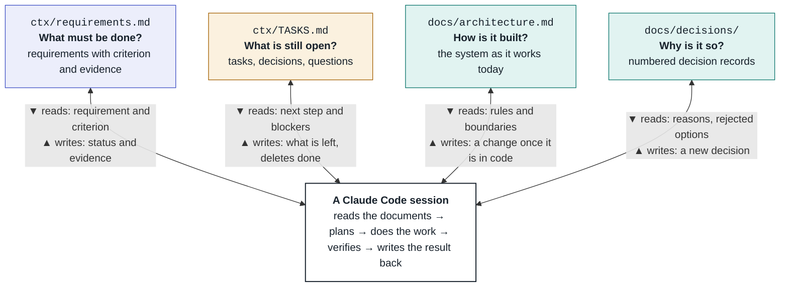

*Shown on a made-up project, Meeting Rooms*

# The documents that tell Claude Code what to do

Claude remembers nothing between two sessions. Whatever it should know has to be written in the project's files. Four documents are enough, and each answers a different question.

You do not write the documents by hand; Claude keeps them. Tell it in the chat, in your own words, what you want, and it writes that down. As the work goes on, it keeps them up to date itself.

The example: a company of 120 people and 8 meeting rooms is building an internal web app for booking rooms. The project is invented; the entries are written the way they would really look in it.

## Map

The `ctx/` folder is about the work: what was ordered and what is open. The `docs/` folder is about the system and stays with the code, because everyone who reads the code needs it. The architecture says how the system is built; the decisions in `docs/decisions/` are its appendix and say why.

## Requirements

`ctx/requirements.md`

The list of what the owner ordered. Each requirement has a number, a priority and, above all, a criterion that settles without discussion whether it is met.

- **Who writes it:** The owner states the requirement. Claude words it and proposes the criterion.
- **When it changes:** When a requirement is added and when work is closed (status and evidence).
- **Rule:** The file only grows. Numbers never change; a cancelled requirement stays, with the reason.

**`ctx/requirements.md`**

`## Intent` – 2-3 sentences: what, for whom, why. `## Out of scope` – what will not be done, each item with a date, e.g. "2026-03-04: approval of bookings by the office manager".

The header is written by brainstorming: the Intent once, the Out of scope only ever added to.

| ID | Priority | Requirement | Source | Acceptance criterion | Status | Evidence |
|---|---|---|---|---|---|---|
| R-001 | MUST | An employee books a free meeting room for a specific time | owner 2026-03-02 | test: a booking of a free slot is saved and visible in the room's schedule; a booking that overlaps another is refused with a message | met | 14 booking tests passed; reviewer OK for both criteria 2026-03-09 |
| R-002 | MUST | A booking nobody showed up for within 10 minutes is released | office manager 2026-03-04 | test: a booking with no check-in is cancelled 10 minutes after its start and the room is free; a checked-in booking stays | approved | — |
| R-003 | SHOULD | The booking appears in the organiser's Outlook calendar | owner 2026-03-04 | the event is in the calendar within 1 minute of the booking; it disappears when the booking is cancelled | partly met | creation works (6 sync tests); cancelling does not delete the event, see `TASKS.md` |

### What to notice

- A test can check the criterion. "Booking should work well" could not be checked.
- Statuses: proposed → approved → met / partly met; cancelled.
- The priority says what may be left out. MUST: work does not close without it. SHOULD: a deviation needs a reason. NICE: if time remains.
- A status without evidence does not count. R-003 is only partly met, and the evidence says exactly what is missing and where it is handled.
- "Met" is written only after a fresh reviewer gave OK with evidence for every criterion. The author's own tests are not enough, which is why R-001's evidence includes an independent reviewer's OK. The owner does not have to try it; if they find later that it does not work, the requirement goes back to "approved" and a new change handles it.

## Open work

`ctx/TASKS.md`

What is still to be done and who it is waiting for. Claude reads this file first at the start of a session to learn where things stopped.

- **Who writes it:** Claude at the end of each piece of work, the owner at any time.
- **When it changes:** All the time. A finished task is deleted, not ticked off.
- **Rule:** It is not a log. History lives in git.

**`ctx/TASKS.md`**

`**Status <date>:**` – one line above the table:

**Status 2026-03-10:** booking works and is deployed as a trial for 20 people. The Outlook sync creates events but does not delete them. Waiting for IT and for one decision by the owner.

| Task | Who acts | What blocks it | Inputs | Next step |
|---|---|---|---|---|
| Automatic release of a booking with no check-in (R-002) | Claude | nothing | R-002; `architecture.md`, section "Booking states" | write the test from the criterion, then add the "unconfirmed" state and a job that runs every minute |
| Cancelling a booking does not delete the Outlook event (R-003) | IT department | the app has no permission to delete events in employees' calendars | sync test result of 2026-03-09 | once the permission is granted, add the deletion and its test; then a fresh reviewer; if they give OK with evidence, R-003 is met |
| May an assistant book on someone else's behalf? | owner | the owner's decision | the office manager's question of 2026-03-06 | if yes, record it as a new requirement R-004 with a criterion |

### What to notice

- The first paragraph is the status in one sentence, with a date. Whoever opens the file a week later knows where the project stands.
- Every task says who acts and what blocks it. Claude will not start on something that is waiting for someone else.
- A task refers to the requirement's number. A question that may turn into a new requirement stays here until the owner decides.

## Architecture

`docs/architecture.md`

A description of the system as it is built today. Claude reads it before a change it concerns, so that it does not break rules already in force.

- **Who writes it:** The worker agent, in the same change that alters the code. The reviewer checks it; the owner sees the change in the summary at wrap-up.
- **When it changes:** Only once the change really is in the code. Plans do not belong here.
- **Rule:** It says "how". "Why" lives in numbered records in `docs/decisions/`.

**`docs/architecture.md`**

| Section | What holds today | What it means for changes | Why |
|---|---|---|---|
| Components | A web page in the browser calls one server. The server stores everything in one PostgreSQL database. Bookings are stored nowhere else. | A new feature must not keep bookings in a file of its own or in the server's memory. | `decisions/0001` |
| Overlapping bookings | Two bookings of the same room must not overlap in time. A rule in the database itself enforces this, not the screen's code. | The check on the screen is only a convenience for the user. The database rule is never switched off, not even for a bulk import. | `decisions/0002` |
| Outlook calendar | The app only writes to Outlook and never reads from it. Changing the event in Outlook does not change the booking. | A booking is moved in the app. Proposing to read changes from Outlook changes a decision, not just code. | `decisions/0003` |

### What to notice

- Every row describes a state you can find in the code. Nothing here is about what is planned.
- Reasons sit in separate files, e.g. `0002-the-database-guards-overlaps.md`. A reversed decision is not deleted; it moves to `docs/decisions/archive/`.
- The "what it means" column is what Claude needs most: what the next change must not break.

## Decisions

`docs/decisions/`

Short numbered records of why the system is built this way. Claude reads them when a proposed change touches a rule from the architecture. That keeps it from proposing again what was already considered and rejected.

- **Who writes it:** The owner decides. Claude prepares the record, alternatives included.
- **When one is written:** When the choice is hard to reverse: the database, a boundary between systems, a rule that existing data must follow. Test: undoing it would mean changing or moving existing data, or another system. An ordinary detail (optional field, option, output format) needs no record.
- **Rule:** One file per decision. Numbers never change and a record is not rewritten. When a new decision replaces it, the old one only gets a pointer to the new one and moves to `docs/decisions/archive/`.

**`docs/decisions/ · 0001 to 0003`**

| No. | Decision | Reason | Alternative considered | What would change it |
|---|---|---|---|---|
| 0001 | Bookings are stored in one database only | Two places drift apart over time and nobody knows which one holds. | Keep bookings directly in Outlook calendars. Rejected: rooms without a calendar would be left out. | The company moving to a system that manages rooms itself. |
| 0002 | The database guards against overlapping bookings | Two people can click in the same second. A check in code does not catch that. | A check on the server just before saving. Rejected: a second booking slips in between the check and the save. | Nothing foreseeable. The rule is cheap and protects the data. |
| 0003 | The app only writes to Outlook | Two-way sync creates disputes over which change holds, and needs wider permissions in calendars. | Read moves and cancellations from Outlook. Postponed, not rejected. | People routinely moving bookings in Outlook and complaining that nothing happens. |

In the project each row is a short file of its own, e.g. `0002-the-database-guards-overlaps.md`.

### What to notice

- The record includes the rejected alternative. Without it, Claude proposes it again a month later.
- "What would change it" says when reopening the decision is worth it. Decision 0003 is postponed, not forbidden.
- The architecture changes with the code; a decision record does not change. When a decision stops holding, a new record is written; the old one only gets a pointer to it and moves to the archive.

## One requirement across the documents

Requirement R-003 (the booking in the Outlook calendar) passed through all the documents in this order.

`ctx/requirements.md`

### 1. The owner says what they want

Row R-003 is added, SHOULD, with the criterion: event in the calendar within 1 minute, gone after cancelling.

`docs/decisions/`

### 2. Claude proposes the approach and the owner approves it

Claude says what it will do and what it will not: changes will not be read from Outlook. The owner agrees and the decision is recorded as 0003.

`code, tests, docs/architecture.md`

### 3. The output is produced, and the architecture with it

The worker writes the event to the calendar and 6 sync tests. In the same change it adds the section "Outlook calendar" to the architecture (the app only writes to Outlook), pointing to decision 0003. The cancellation test fails: cancelling does not delete the event from the calendar.

`ctx/requirements.md`

### 4. The result has a gap

The reviewer gives the verdict `FIX`. Two fix rounds cannot fix it: the app has no permission to delete events in the calendar, and code cannot change that. Claude stops and tells the owner in plain words. The owner accepts the gap. The status stays `approved`; the evidence and the new status are written together at wrap-up.

`ctx/requirements.md`

### 5. The owner accepts the result and the status is written

Creating works, cancelling does not. The owner accepts the result: status partly met; the evidence says what is missing. Claude tells them what they can try.

`ctx/TASKS.md`

### 6. What is left goes to open work

The task "Cancelling a booking does not delete the Outlook event" is added. IT acts, and the next step is clear.

## How to use it in Claude Code

With the b6 plugin it is enough to say what you want. Claude reads what it needs on its own and writes the documents only after you agree: requirements after brainstorming, status and evidence at wrap-up, "met" only after an independent check with evidence. Manual commands such as "add R-004" are not needed; they would skip the approval and the check.

> **At the start of a session**
>
> Where are we?

> **When a new requirement arrives**
>
> The owner decided that an assistant can book on someone else's behalf. Let's add it.

> **When a hard-to-reverse choice is needed**
>
> I want people to sign in with their company Microsoft account. What are the options?

> **When something does not work**
>
> This does not work: after cancelling a booking the event stays in the calendar.

### What goes where

| I have | It goes to | Not to |
|---|---|---|
| A new wish from the owner | `requirements.md` | TASKS.md. A task without a criterion cannot be closed. |
| Unfinished work, a question, waiting for someone | `TASKS.md` | requirements.md. It holds only ordered results. |
| A description of how the system works | `architecture.md` | TASKS.md. A task disappears when done; the description of the system has to stay. |
| The reason for a hard-to-reverse decision | `docs/decisions/` | architecture.md. It says "how", not "why". |

### Three beginner mistakes

- TASKS.md as a list of ticked-off tasks. After a month nobody can find the open work in it.
- A requirement without an acceptance criterion. Claude then declares "done" by its own judgement.
- An architecture that describes plans. Claude takes it as fact and writes code against something that does not exist.

@panthea.sk
