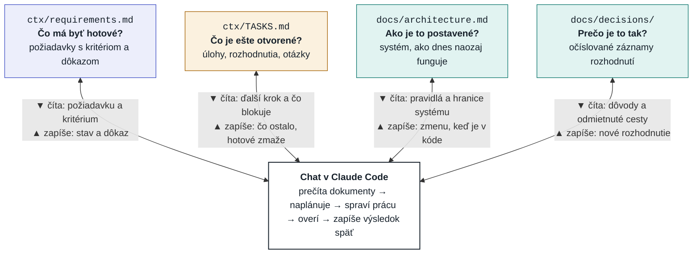

*Ukážka na vymyslenom projekte Zasadačky*

# Dokumenty, podľa ktorých Claude Code vie, čo robiť

Claude si medzi dvoma chatmi nič nepamätá. Čo má vedieť, musí byť zapísané v súboroch projektu. Stačia na to štyri dokumenty a každý odpovedá na inú otázku.

Dokumenty netreba písať ručne, vedie ich Claude. Stačí mu v chate vlastnými slovami povedať, čo treba, a on to zapíše. Počas práce ich potom sám priebežne dopĺňa.

Príklad: firma so 120 ľuďmi a 8 zasadačkami si robí internú webovú aplikáciu na rezerváciu zasadačiek. Projekt je vymyslený, zápisy sú napísané tak, ako by v ňom naozaj vyzerali.

## Mapa

Priečinok `ctx/` je o práci: čo je objednané a čo je otvorené. Priečinok `docs/` je o systéme a ostáva pri kóde, lebo ho potrebuje každý, kto kód číta. Architektúra hovorí, ako je systém postavený, rozhodnutia v `docs/decisions/` sú jej príloha a hovoria prečo.

## Požiadavky

`ctx/requirements.md`

Zoznam toho, čo si vlastník objednal. Každá požiadavka má číslo, prioritu a hlavne kritérium, podľa ktorého sa dá bez diskusie povedať, či je splnená.

- **Kto zapisuje:** Požiadavku diktuje vlastník. Claude ju sformuluje a navrhne kritérium.
- **Kedy sa mení:** Keď pribudne požiadavka a keď sa práca uzavrie (stav a dôkaz).
- **Pravidlo:** Súbor sa len dopĺňa. Čísla sa nemenia, zrušená požiadavka ostáva s dôvodom.

**`ctx/requirements.md`**

`## Zámer` – 2–3 vety: čo, pre koho, prečo. `## Mimo rozsahu` – čo sa nebude robiť, každá položka s dátumom, napr. „2026-03-04: schvaľovanie rezervácií office manažérkou“.

Hlavičku zapisuje brainstorming: Zámer raz, Mimo rozsahu sa iba dopĺňa.

| ID | Priorita | Požiadavka | Zdroj | Kritérium splnenia | Stav | Dôkaz |
|---|---|---|---|---|---|---|
| R-001 | MUST | Zamestnanec si rezervuje voľnú zasadačku na konkrétny čas | vlastník 2026-03-02 | test: rezervácia voľného termínu sa uloží a je viditeľná v rozvrhu zasadačky; rezervácia, ktorá sa prekrýva s inou, je odmietnutá s hláškou | splnená | 14 testov rezervácie prešlo; reviewer OK pre obe kritériá 2026-03-09 |
| R-002 | MUST | Rezervácia, na ktorú do 10 minút nikto neprišiel, sa uvoľní | office manažérka 2026-03-04 | test: rezervácia bez potvrdenia príchodu je 10 minút po začiatku zrušená a zasadačka je voľná; potvrdená rezervácia ostáva | schválená | — |
| R-003 | SHOULD | Rezervácia sa objaví v kalendári Outlook organizátora | vlastník 2026-03-04 | udalosť je v kalendári do 1 minúty po vytvorení rezervácie; po zrušení rezervácie z kalendára zmizne | čiastočne splnená | vytvorenie funguje (6 testov synchronizácie); zrušenie udalosť nemaže, pozri `TASKS.md` |

### Čo si všimnúť

- Kritérium sa dá overiť testom. „Rezervácia má fungovať dobre“ by sa overiť nedalo.
- Stavy: návrh → schválená → splnená / čiastočne splnená; zrušená.
- Priorita hovorí, čo sa smie vynechať. MUST: bez nej sa práca neuzavrie. SHOULD: odchýlka sa zdôvodní. NICE: ak ostane čas.
- Stav bez dôkazu neplatí. R-003 je len čiastočne splnená a dôkaz hovorí presne, čo chýba a kde sa to rieši.
- „Splnená“ sa zapíše až po tom, čo čerstvý reviewer dal OK s dôkazom pre každé kritérium. Testy samotného autora nestačia, preto je pri R-001 dôkazom aj OK nezávislého reviewera. Vlastník to skúšať nemusí; ak neskôr zistí, že to nefunguje, požiadavka sa vráti na „schválená“ a rieši sa novou zmenou.

## Otvorená práca

`ctx/TASKS.md`

Čo treba ešte spraviť a na kom to stojí. Tento súbor číta Claude na začiatku chatu ako prvý, aby vedel, kde sa skončilo.

- **Kto zapisuje:** Claude na konci každej práce, vlastník kedykoľvek.
- **Kedy sa mení:** Stále. Hotová úloha sa vymaže, nie odškrtne.
- **Pravidlo:** Nie je to denník. História je v gite.

**`ctx/TASKS.md`**

`**Stav <dátum>:**` – jeden riadok nad tabuľkou:

**Stav 2026-03-10:** rezervovanie funguje a je nasadené na skúšku pre 20 ľudí. Synchronizácia s Outlookom udalosti vytvára, ale nemaže. Čaká sa na IT a na jedno rozhodnutie vlastníka.

| Úloha | Kto koná | Čo ju blokuje | Vstupy | Ďalší krok |
|---|---|---|---|---|
| Automatické uvoľnenie nepotvrdenej rezervácie (R-002) | Claude | nič | R-002; `architecture.md`, časť „Stavy rezervácie“ | napísať test podľa kritéria, potom doplniť stav „nepotvrdená“ a úlohu, ktorá beží každú minútu |
| Zrušenie rezervácie nemaže udalosť v Outlooku (R-003) | IT oddelenie | aplikácia nemá právo mazať udalosti v kalendároch zamestnancov | výsledok testu synchronizácie z 2026-03-09 | po pridelení práva doplniť mazanie a test; potom nový reviewer; ak dá OK s dôkazom, R-003 splnená |
| Smie asistentka rezervovať v mene niekoho iného? | vlastník | rozhodnutie vlastníka | otázka office manažérky z 2026-03-06 | ak áno, zapísať ako novú požiadavku R-004 s kritériom |

### Čo si všimnúť

- Prvý odsek je stav jednou vetou a dátum. Kto súbor otvorí po týždni, vie, kde projekt je.
- Pri každej úlohe je, kto koná a čo ju blokuje. Claude tak nezačne robiť niečo, čo čaká na iného.
- Úloha sa odvoláva na číslo požiadavky. Otázka, z ktorej môže vzniknúť nová požiadavka, je tu, kým ju vlastník nerozhodne.

## Architektúra

`docs/architecture.md`

Opis systému tak, ako je dnes postavený. Claude ho číta pred zmenou, ktorej sa týka, aby neporušil pravidlá, ktoré už platia.

- **Kto zapisuje:** Agent worker v tej istej zmene, ktorá mení kód. Kontroluje ju reviewer; vlastník zmenu vidí v zhrnutí pri uzavretí.
- **Kedy sa mení:** Až keď je zmena naozaj v kóde. Plány sem nepatria.
- **Pravidlo:** Hovorí „ako“. „Prečo“ je v očíslovaných záznamoch v `docs/decisions/`.

**`docs/architecture.md`**

| Kapitola | Čo dnes platí | Čo z toho vyplýva pre zmeny | Prečo |
|---|---|---|---|
| Súčasti | Webová stránka v prehliadači volá jeden server. Server ukladá všetko do jednej databázy PostgreSQL. Rezervácie nie sú uložené nikde inde. | Nová funkcia nesmie držať rezervácie vo vlastnom súbore ani v pamäti servera. | `decisions/0001` |
| Prekrývanie rezervácií | Dve rezervácie tej istej zasadačky sa nesmú časovo prekrývať. Stráži to pravidlo priamo v databáze, nie kód obrazovky. | Kontrola na obrazovke je len pohodlie pre používateľa. Pravidlo v databáze sa nevypína ani pri hromadnom importe. | `decisions/0002` |
| Kalendár Outlook | Aplikácia do Outlooku len zapisuje, nikdy z neho nečíta. Zmena udalosti v Outlooku rezerváciu nezmení. | Presun rezervácie sa robí v aplikácii. Kto navrhne čítať zmeny z Outlooku, mení rozhodnutie, nie len kód. | `decisions/0003` |

### Čo si všimnúť

- Každý riadok opisuje stav, ktorý sa dá v kóde nájsť. O tom, čo sa plánuje, tu nie je nič.
- Dôvody sú v samostatných súboroch, napr. `0002-prekryvanie-strazi-databaza.md`. Zrušené rozhodnutie sa nemaže, presunie sa do `docs/decisions/archive/`.
- Stĺpec „čo z toho vyplýva“ je to, čo Claude potrebuje najviac: čo pri ďalšej zmene nesmie pokaziť.

## Rozhodnutia

`docs/decisions/`

Krátke očíslované záznamy o tom, prečo je systém postavený práve takto. Claude ich číta, keď sa navrhovaná zmena dotýka pravidla z architektúry. Nenavrhne tak znova to, čo už bolo raz zvážené a odmietnuté.

- **Kto zapisuje:** Rozhoduje vlastník. Claude pripraví záznam aj s alternatívami.
- **Kedy vzniká:** Keď sa voľba ťažko vracia: databáza, hranica medzi systémami, pravidlo, ktoré musia dodržať existujúce dáta. Skúška: vrátenie by znamenalo meniť alebo presúvať existujúce dáta alebo iný systém. Bežný detail (nepovinné pole, voľba, formát výstupu) záznam nepotrebuje.
- **Pravidlo:** Jeden súbor na rozhodnutie. Čísla sa nemenia a záznam sa neprepisuje. Keď ho nové rozhodnutie nahradí, do starého pribudne iba odkaz na nový a starý sa presunie do `docs/decisions/archive/`.

**`docs/decisions/ · 0001 až 0003`**

| Č. | Rozhodnutie | Dôvod | Zvažovaná alternatíva | Čo by ho zmenilo |
|---|---|---|---|---|
| 0001 | Rezervácie sú uložené len v jednej databáze | Dve miesta sa časom rozídu a nik nevie, ktoré platí. | Viesť rezervácie priamo v kalendároch Outlook. Odmietnuté: zasadačky bez kalendára by ostali mimo. | Prechod firmy na systém, ktorý zasadačky spravuje sám. |
| 0002 | Prekrývanie rezervácií stráži databáza | Dvaja ľudia môžu kliknúť v tej istej sekunde. Kontrola v kóde to nezachytí. | Kontrola na serveri tesne pred uložením. Odmietnuté: medzi kontrolou a uložením vkĺzne druhá rezervácia. | Nič predvídateľné. Pravidlo je lacné a chráni dáta. |
| 0003 | Do Outlooku sa len zapisuje | Obojsmerná synchronizácia vytvára spory, ktorá zmena platí, a vyžaduje širšie práva do kalendárov. | Čítať presuny a zrušenia z Outlooku. Odložené, nie odmietnuté. | Ľudia budú rezervácie bežne presúvať v Outlooku a sťažovať sa, že sa to neprejaví. |

V projekte je každý riadok samostatný krátky súbor, napr. `0002-prekryvanie-strazi-databaza.md`.

### Čo si všimnúť

- Záznam obsahuje aj odmietnutú alternatívu. Bez nej ju Claude o mesiac navrhne znova.
- „Čo by ho zmenilo“ hovorí, kedy sa oplatí rozhodnutie otvoriť. Rozhodnutie 0003 je odložené, nie zakázané.
- Architektúra sa mení s kódom, záznam o rozhodnutí sa nemení. Keď rozhodnutie prestane platiť, vznikne nový záznam; do starého pribudne iba odkaz naň a starý ide do archívu.

## Jedna požiadavka naprieč dokumentmi

Požiadavka R-003 (rezervácia v kalendári Outlook) prešla všetkými dokumentmi v tomto poradí.

`ctx/requirements.md`

### 1. Vlastník povie, čo chce

Vznikne riadok R-003, SHOULD, s kritériom: udalosť v kalendári do 1 minúty, po zrušení zmizne.

`docs/decisions/`

### 2. Claude navrhne postup a vlastník ho schváli

Claude povie, čo spraví a čo nie: zmeny z Outlooku sa čítať nebudú. Vlastník súhlasí a rozhodnutie sa zapíše ako 0003.

`kód, testy, docs/architecture.md`

### 3. Vznikne výstup a s ním architektúra

Worker napíše zápis udalosti do kalendára a 6 testov synchronizácie. V tej istej zmene doplní do architektúry kapitolu „Kalendár Outlook“ (aplikácia do Outlooku len zapisuje) s odkazom na rozhodnutie 0003. Test zrušenia zlyhá: zrušenie udalosť z kalendára nezmaže.

`ctx/requirements.md`

### 4. Výsledok má medzeru

Reviewer dá verdikt `FIX`. Ani dve opravné kolá to neopravia: aplikácia nemá právo mazať udalosti v kalendári a kódom sa to opraviť nedá. Claude sa zastaví a povie to vlastníkovi jednoduchými slovami. Vlastník medzeru prijme. Stav zostáva `schválená`; dôkaz a nový stav sa zapíšu spolu pri uzavretí.

`ctx/requirements.md`

### 5. Vlastník prijme výsledok a zapíše sa stav

Vytvorenie funguje, zrušenie nie. Vlastník výsledok prijme: stav čiastočne splnená; do dôkazu sa zapíše, čo chýba. Claude mu povie, čo si môže vyskúšať.

`ctx/TASKS.md`

### 6. Čo ostalo, ide do otvorenej práce

Pribudne úloha „Zrušenie rezervácie nemaže udalosť v Outlooku“. Koná IT oddelenie, ďalší krok je jasný.

## Ako to použiť v Claude Code

S pluginom b6 stačí povedať, čo chceš. Claude si sám prečíta, čo treba, a dokumenty zapisuje až po tvojom súhlase: požiadavky po brainstormingu, stav a dôkaz pri uzavretí, „splnená“ až po nezávislej kontrole s dôkazom. Ručné pokyny typu „pridaj R-004“ netreba; obišli by schválenie aj kontrolu.

> **Na začiatku chatu**
>
> Kde sme?

> **Keď príde nová požiadavka**
>
> Vlastník rozhodol, že asistentka môže rezervovať v mene iného. Poďme to pridať.

> **Keď treba ťažko vratné rozhodnutie**
>
> Chcem, aby sa prihlasovalo firemným účtom Microsoft. Aké sú možnosti?

> **Keď niečo nefunguje**
>
> Toto nefunguje: pri zrušení rezervácie ostane udalosť v kalendári.

### Kam čo patrí

| Mám v ruke | Patrí do | Nie do |
|---|---|---|
| Nové želanie vlastníka | `requirements.md` | TASKS.md. Úloha bez kritéria sa nedá uzavrieť. |
| Nedokončenú prácu, otázku, čakanie na niekoho | `TASKS.md` | requirements.md. Tam sú len objednané výsledky. |
| Opis toho, ako systém funguje | `architecture.md` | TASKS.md. Úloha po dokončení zmizne, opis systému má ostať. |
| Dôvod ťažko vratného rozhodnutia | `docs/decisions/` | architecture.md. Tá hovorí „ako“, nie „prečo“. |

### Tri chyby začiatočníka

- TASKS.md ako zoznam odškrtnutých úloh. Po mesiaci v ňom otvorenú prácu nik nenájde.
- Požiadavka bez kritéria splnenia. Claude potom vyhlási „hotovo“ podľa vlastného úsudku.
- Architektúra, ktorá opisuje plány. Claude ju berie ako fakt a píše kód proti niečomu, čo neexistuje.

@panthea.sk
